# Лабораторная работа №9. Работа с Git

**Репозиторий:** <https://github.com/Murcklack/slow-learning-of-C>
**Рабочая папка:** `Программы/Язык-C/9 практика`

> Примечание: в этом репозитории основная ветка называется `main`, а не `master`, поэтому все команды из задания выполнялись с `main`. Смысл работы от этого не меняется.

---

## Часть 1. Базовые операции (оценка 3)

### 1. Определение текущей ветки

```
git status
```

Находимся на ветке `main`, ветка соответствует `origin/main`, изменений нет.

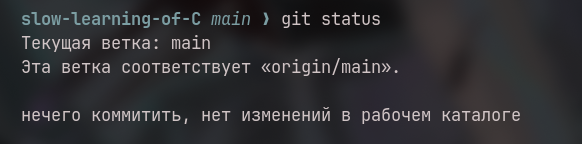

### 2. Журнал коммитов

```
git log
```

Видна история коммитов репозитория: автор, дата и сообщение каждого коммита.

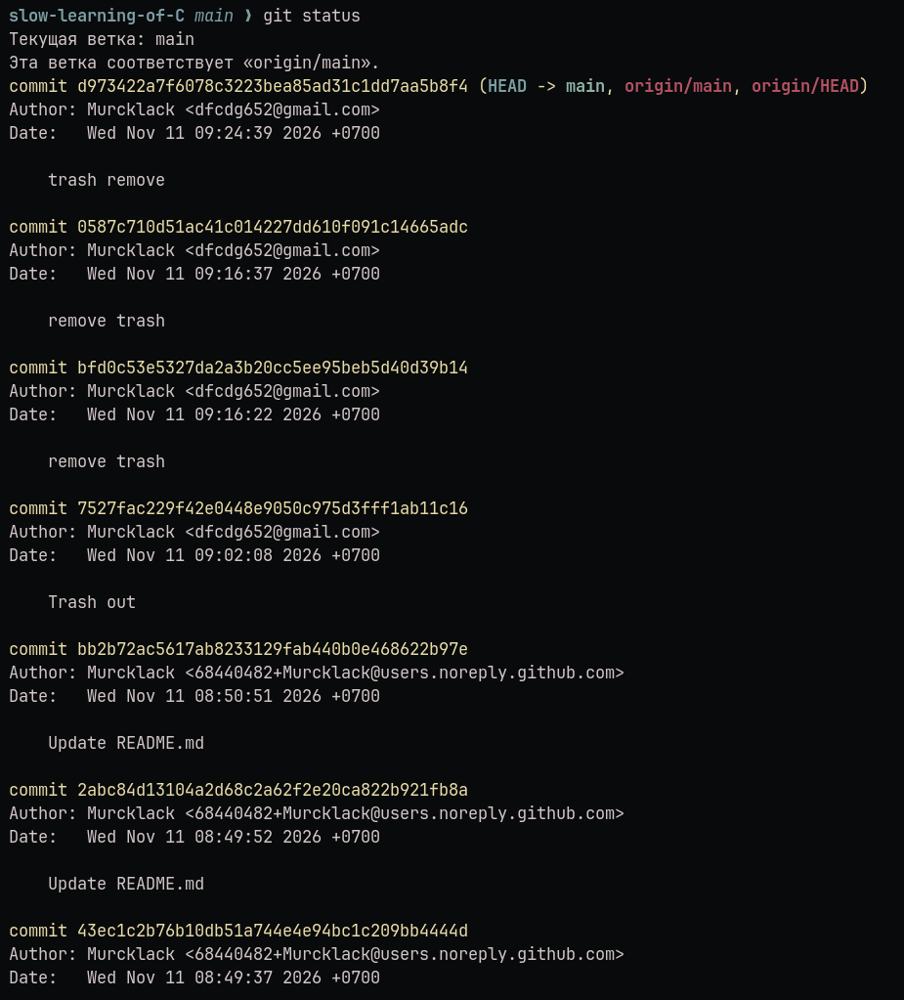

### 3. Создание файла `sort.c`

В файл `sort.c` помещена только функция сортировки — сортировка пузырьком:

```c
// Сортировка пузырьком (по возрастанию)
// arr - массив, size - количество элементов
void bubble_sort(int *arr, int size)
{
    for (int i = 0; i < size - 1; i++)
    {
        int swapped = 0;

        for (int j = 0; j < size - 1 - i; j++)
        {
            if (arr[j] > arr[j + 1])
            {
                int temp = arr[j];
                arr[j] = arr[j + 1];
                arr[j + 1] = temp;

                swapped = 1;
            }
        }

        // если за проход не было обменов, массив уже отсортирован
        if (!swapped)
        {
            break;
        }
    }
}
```

### 4. `git status` после создания файла

Git показывает неотслеживаемые файлы (untracked) — новый файл ещё не известен репозиторию.

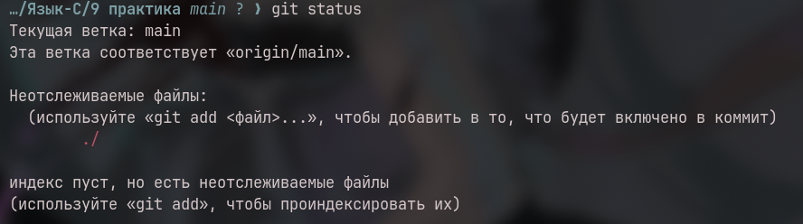

### 5–6. Добавление файла в stage и `git status`

```
git add sort.c
git status
```

Файл попал в область индексации: появился раздел «Изменения, которые будут включены в коммит» → `новый файл: sort.c`.

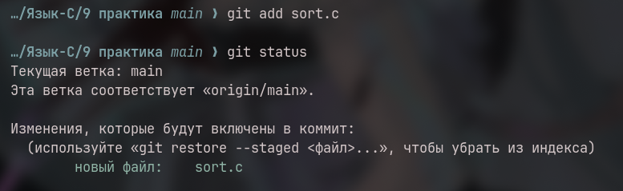

### 7. Коммит файла

```
git commit -m "lab 9"
```

Коммит `140fc9e`, изменён 1 файл, добавлено 27 строк.

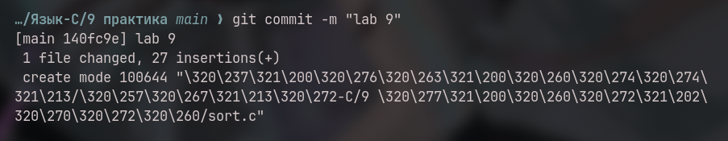

### 8. `git status` после коммита

Рабочий каталог чистый, индекс пуст — коммитить больше нечего.

### 9. Добавление комментария в `sort.c`

```
echo "//Не убегай, это я твой коментарий, всё хрошо" >> sort.c
```

В конец файла добавлена строка-комментарий.


### 10. `git status` после изменения файла

Файл `sort.c` теперь отображается как изменённый, но ещё не добавленный в индекс.

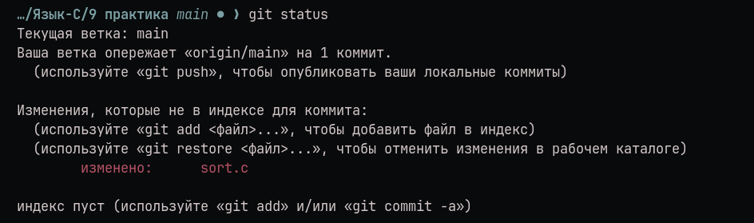

### 11–12. Добавление изменения в stage и `git status`

```
git add sort.c
git status
```

Изменение перешло в раздел «Изменения, которые будут включены в коммит» → `изменено: sort.c`.

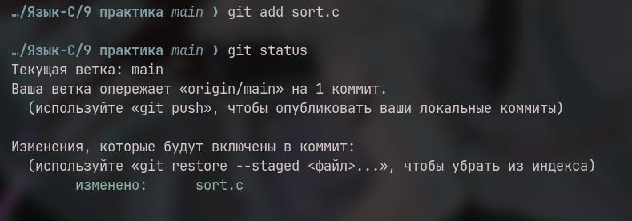

### 13. Повторное изменение файла

```
echo "//Да ладно тебе, никто ещё не умирал" >> sort.c
```

Добавлен ещё один комментарий. (Заодно на скриншоте видна опечатка — команда `git` без аргументов, которая вывела список подкоманд.)

### 14–15. Коммит и `git status` / `git log`

```
git commit -m "comms"
git status
```

Создан коммит `4c35401` — в него попало только то изменение, которое было в индексе (первый комментарий). Второй комментарий остался в рабочем каталоге как незакоммиченное изменение, о чём и сообщает `git status` («Ваша ветка опережает origin/main на 2 коммита» + `изменено: sort.c`).

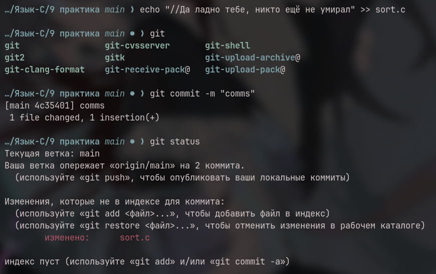

Журнал коммитов на этом этапе:

```
* 4c35401 comms
* 140fc9e lab 9
* d973422 trash remove
...
```

### 16. Добавление последнего изменения и коммит

```
git add sort.c
git commit -m "another comm..."
```

Создан коммит `5cbd10c`, в него вошёл второй комментарий.

### 17. Отправка в удалённый репозиторий

```
git push
```

Объекты успешно отправлены: `d973422..5cbd10c  main -> main`.

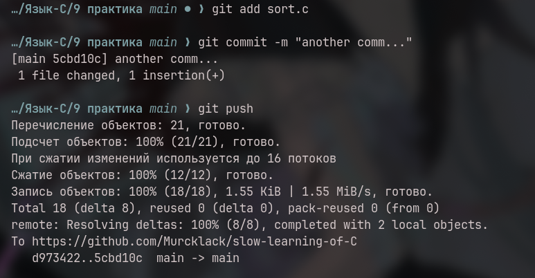

---

## Часть 2. Ветки

### 1–3. Создание и переключение на ветку `mybranch`

```
git checkout -b mybranch
git branch
git checkout mybranch
```

Ветка создана и активна (звёздочкой отмечена `mybranch`).

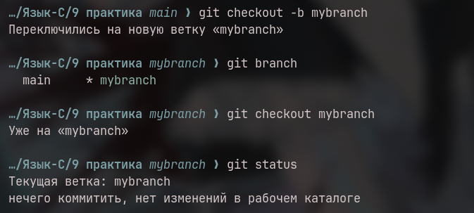

### 4. Как меняется `git status` при переключении веток

После переключения на `main` вывод `git status` показывает уже другую ветку:

```
Текущая ветка: main
Эта ветка соответствует «origin/main».

нечего коммитить, нет изменений в рабочем каталоге
```

То есть `git status` всегда сообщает, на какой ветке вы находитесь, и с какой удалённой веткой она связана.

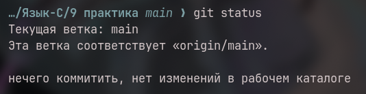

### 5–7. Файл `file1.txt` в ветке `mybranch`

Убедились, что находимся на `mybranch`, создали файл со своим именем и закоммитили:

```
echo "Матвей" > file1.txt
git add file1.txt
git commit -m "name_file"
```

Коммит `2003d42`.

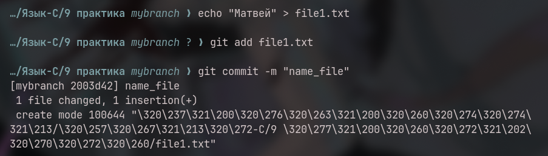

### 8. `git log --oneline --graph` в ветке `mybranch`

Ветка `mybranch` указывает на новый коммит `2003d42 name_file`, который находится выше `main`.

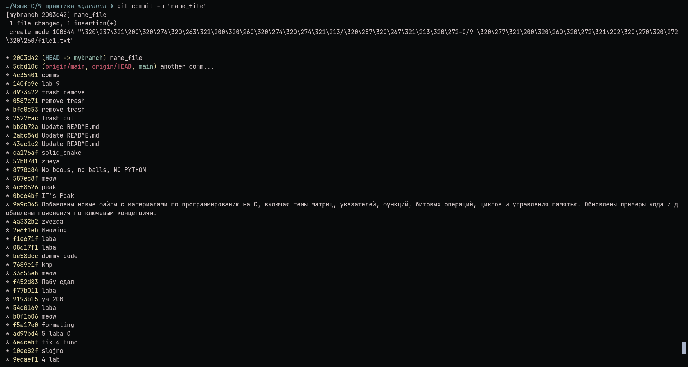

### 9–10. Возврат на `main` и журнал

```
git switch main
git log --oneline --graph
```

В журнале `main` коммита `name_file` уже нет: ветки разошлись, `main` остался на `5cbd10c another comm...`.

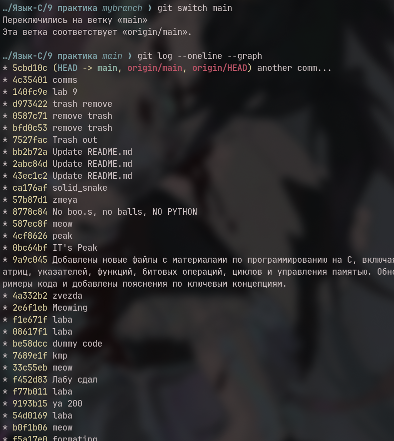

### 11–12. Файл `file2.txt` в ветке `main`

```
echo "Murcklack" > file2.txt
git add file2.txt
git commit -m "Name2"
```

Коммит `fded397 Name2`. Вывод `git log --oneline --graph --all` показывает, что теперь у двух веток разные коммиты: `main` → `fded397`, `mybranch` → `2003d42`.

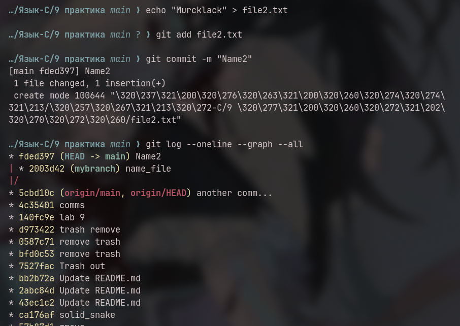

### 13–14. Переключение обратно на `mybranch`: пропал ли `file2.txt`?

```
git switch mybranch
ls
```

Да, `file2.txt` «пропал» — в этой ветке его никогда не было. В каталоге остались только `file1.txt` и `sort.c`. Файл никуда не удалился: он закоммичен в ветке `main` и появится снова при переключении на неё.

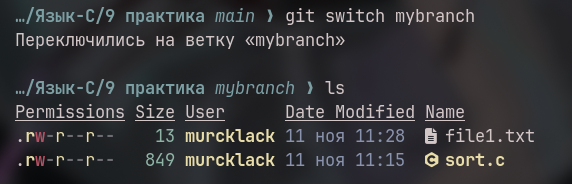

### 15. Разница между ветками

```
git diff mybranch main
```

Diff показывает различия: в `main` есть `file2.txt` (и нет `file1.txt`), а в `mybranch` — наоборот, есть `file1.txt` с содержимым «Матвей».

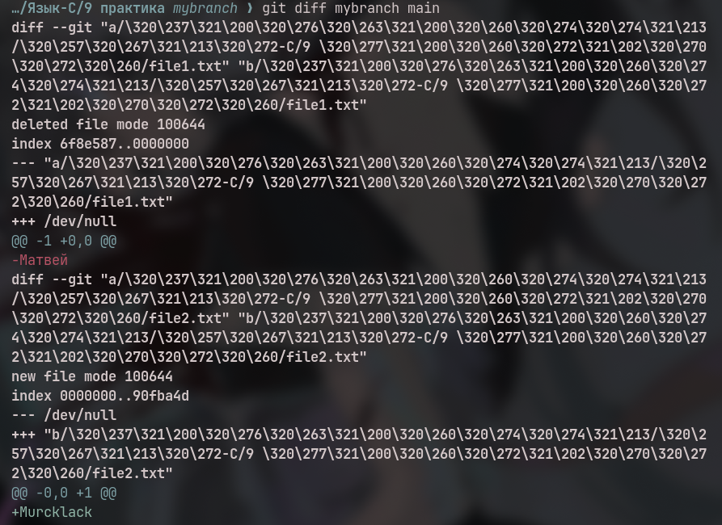

### 16. Документ со скриншотами, коммит и push ветки `mybranch`

В ветку `mybranch` добавляется этот отчёт (`ОТЧЕТ_3.md`) вместе с папкой `screenshots/`, после чего изменения коммитятся и ветка отправляется на GitHub:

```
git add ОТЧЕТ_3.md screenshots
git commit -m "Отчёт по лабораторной работе №9"
git push -u origin mybranch
```

### 17. Проверка веток на GitHub

В удалённом репозитории должны быть видны две ветки — `main` и `mybranch`. Изменения ветки `main` также отправлены в `origin/main`.

---

## Итог

В ходе работы были отработаны:

- просмотр состояния репозитория (`git status`) и истории (`git log`);
- добавление файлов в индекс (`git add`) и создание коммитов (`git commit`);
- отправка изменений на удалённый репозиторий (`git push`);
- создание и переключение веток (`git checkout -b`, `git switch`, `git branch`);
- просмотр истории в виде графа (`git log --oneline --graph --all`);
- сравнение веток (`git diff`);
- понимание того, что файлы принадлежат коммитам/веткам, а не «рабочей папке»: `file2.txt` не виден в `mybranch`, потому что он закоммичен только в `main`.
