# Лабораторная работа №9. Работа с Git — часть 2 (оценка 4)

**Студент:** Матвей (Murcklack)
**Репозиторий:** <https://github.com/Murcklack/slow-learning-of-C>
**Рабочая папка:** `Программы/Язык-C/9 практика`

> Это продолжение отчёта `ОТЧЕТ_3.md` (задание на оценку 3). В репозитории основная ветка называется `main`, поэтому вместо `master` используется она.

---

## Часть 1. `sort.c`: diff, индекс и restore

### 1. Переключение на ветку `mybranch`

```
git switch mybranch
```

В ветке `mybranch` лежит `sort.c` с функцией сортировки из предыдущей части. При переключении Git предупредил о незакоммиченном удалении файла `test/lol.c` (оно «переехало» из рабочего каталога), после чего сообщил, что ветка опережает `origin/mybranch` на 1 коммит.

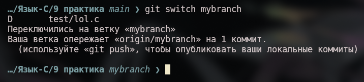

### 2. Перезапись `sort.c`: добавлена функция `main()`

В файл добавлены `#include <stdio.h>` и `main()`, в котором объявлен массив `int a[] = {4, 2, 0};`, вычисляется его размер и вызывается `bubble_sort`, после чего массив выводится на экран.

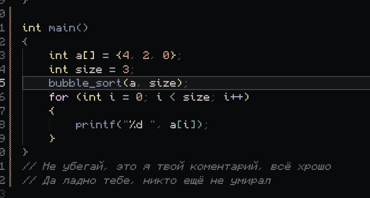

### 3. Что говорит `git diff`?

```
git diff
```

`git diff` показывает разницу между **рабочим каталогом** и **индексом** (тем, что подготовлено к коммиту). Так как изменения ещё не добавлены в индекс, видно всё, что мы изменили: добавленный `#include <stdio.h>`, новую функцию `main()` и перенесённые комментарии.

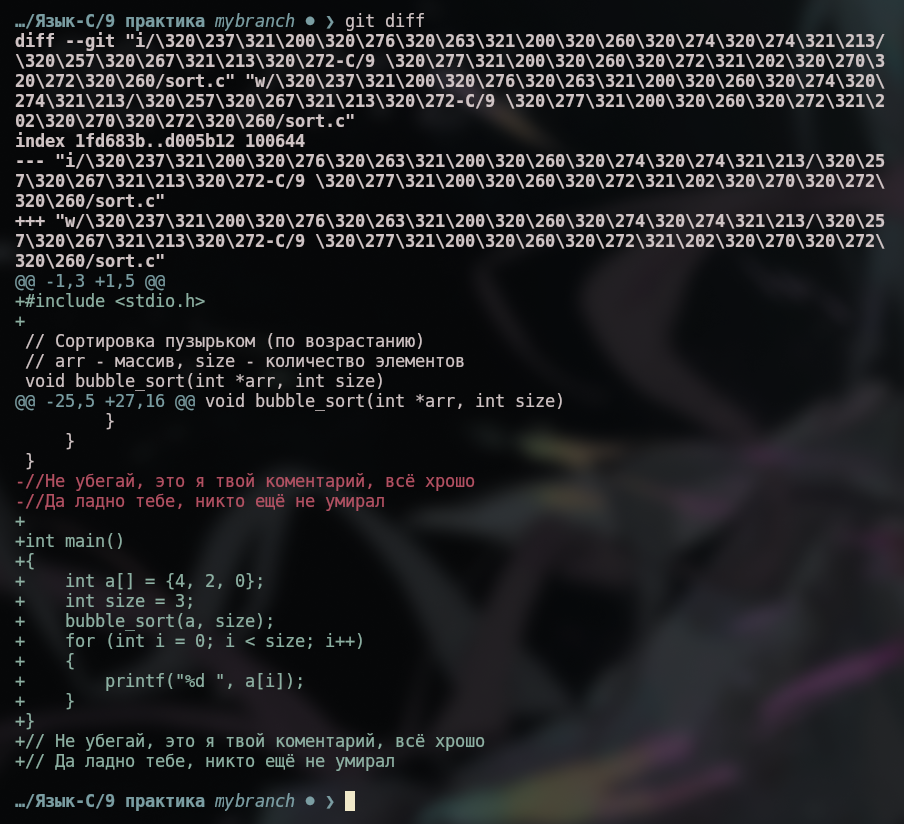

### 4. Что говорит `git diff --staged`?

```
git diff --staged
```

Вывод пустой: в индексе пока нет никаких изменений, мы ещё ничего не делали через `git add`.


### 5–7. Добавление `sort.c` в индекс и снова diff

```
git add sort.c
git diff
git diff --staged
```

- `git diff` теперь **пустой** — рабочая версия файла совпадает с тем, что лежит в индексе.
- `git diff --staged` показывает изменения между **последним коммитом (HEAD)** и **индексом** — то есть ровно то, что попадёт в следующий коммит.

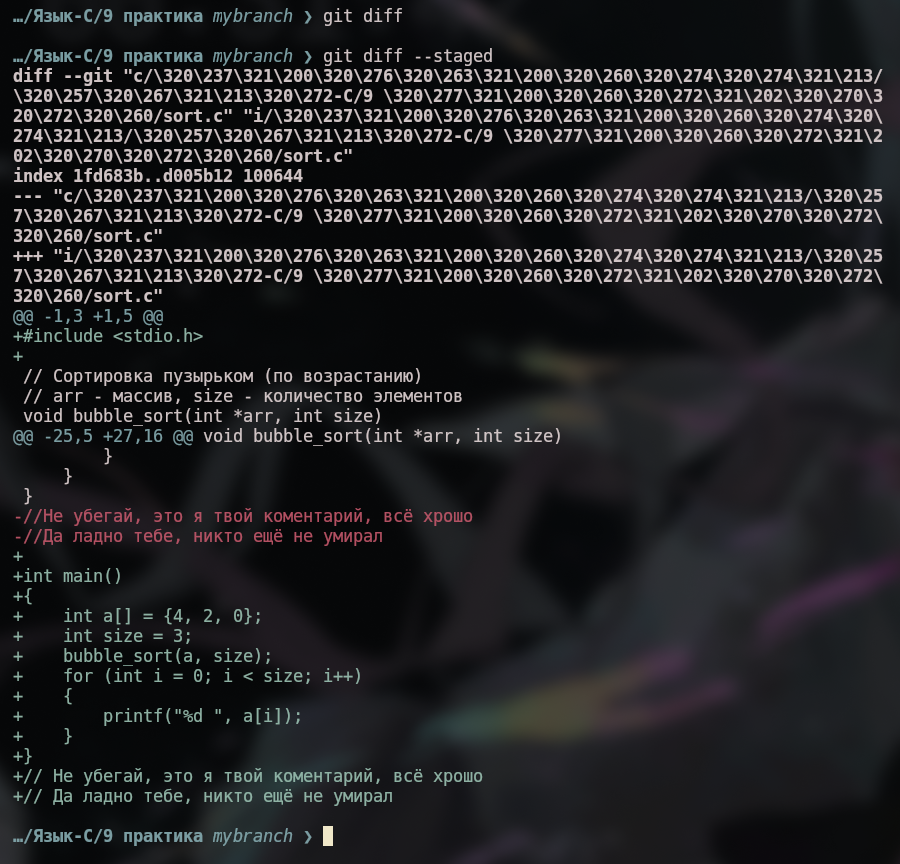

### 8–11. Удаление числа из массива и объяснение

Удалим `0` из массива: было `int a[] = {4, 2, 0};`, стало `int a[] = {4, 2};` (и `size = 2`).

**`git diff`** показывает только это новое изменение — удаление `0` и уменьшение размера:

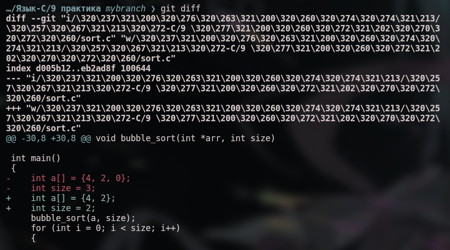

**`git diff --staged`** по-прежнему показывает старую, уже проиндексированную версию с `{4, 2, 0}`:

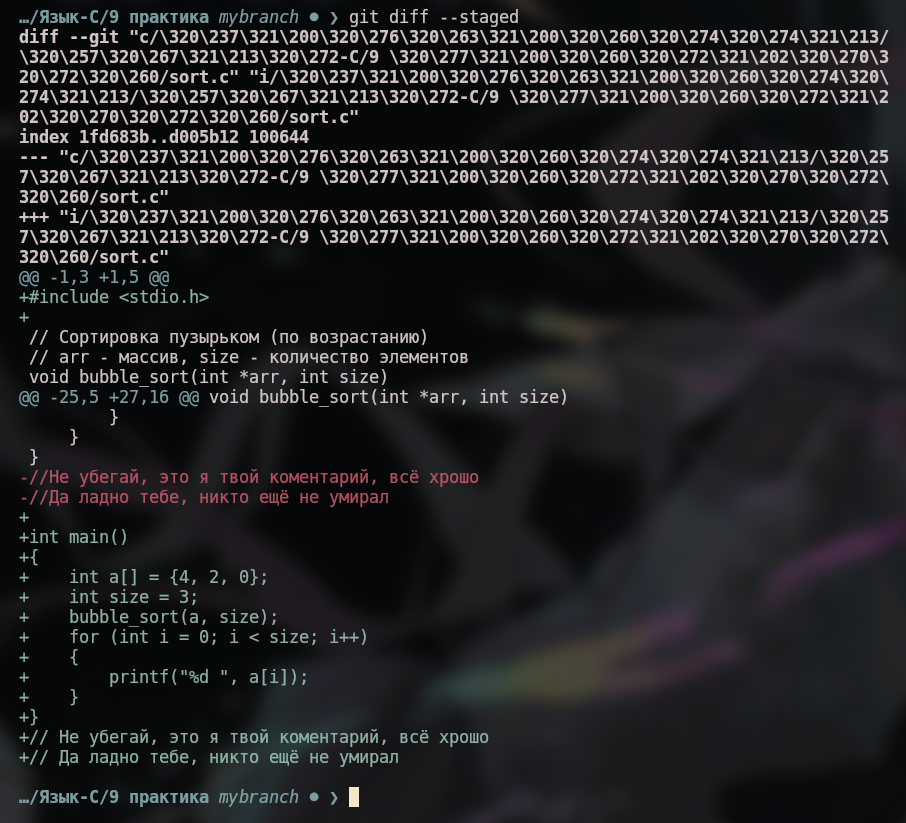

**Что происходит.** У файла есть три версии:

| Версия | Где хранится | Что в ней |
|---|---|---|
| `HEAD` | последний коммит | старый `sort.c` без `main()` |
| индекс (stage) | подготовлено к коммиту | `sort.c` с `main()` и массивом `{4, 2, 0}` |
| рабочий каталог | файл на диске | `sort.c` с `main()` и массивом `{4, 2}` |

`git diff` сравнивает «рабочий каталог ↔ индекс», поэтому показывает только последнее удаление. `git diff --staged` сравнивает «индекс ↔ HEAD», поэтому показывает всё, что было добавлено ранее, и не замечает правку после `git add`.

### 12. `git status`: `sort.c` присутствует дважды

```
git status
```

Файл `sort.c` действительно выводится два раза:

- в блоке «Изменения, которые будут включены в коммит» — проиндексированная версия;
- в блоке «Изменения, которые не в индексе для коммита» — более новая правка в рабочем каталоге.

Git честно показывает, что в индекс и в рабочем каталоге лежат разные версии одного файла.

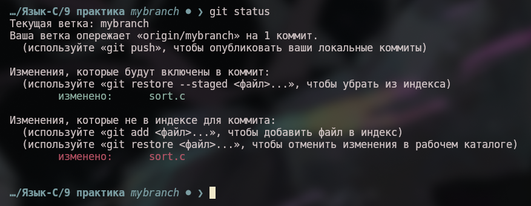

### 13–14. Отмена индексации

```
git restore --staged sort.c
git status
```

Файл убран из индекса, но изменения на диске остались: `sort.c` теперь только в разделе «Изменения, которые не в индексе», а индекс пуст. Команда `git restore --staged` отменяет только `git add`, сам файл не трогает.

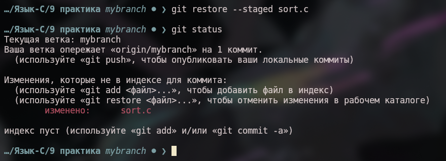

### 15–16. Индексация, коммит и журнал

```
git add sort.c
git commit -m "sort.c update"
```

Коммит `b514baa`: 1 файл изменён, 15 добавлений, 2 удаления.

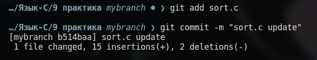

Журнал:

```
* b514baa (HEAD -> mybranch) sort.c update
* 77ab2dd Отчёт по лабораторной работе №9
* 2003d42 (origin/mybranch) name_file
* 5cbd10c (origin/main, origin/HEAD) another comm...
...
```

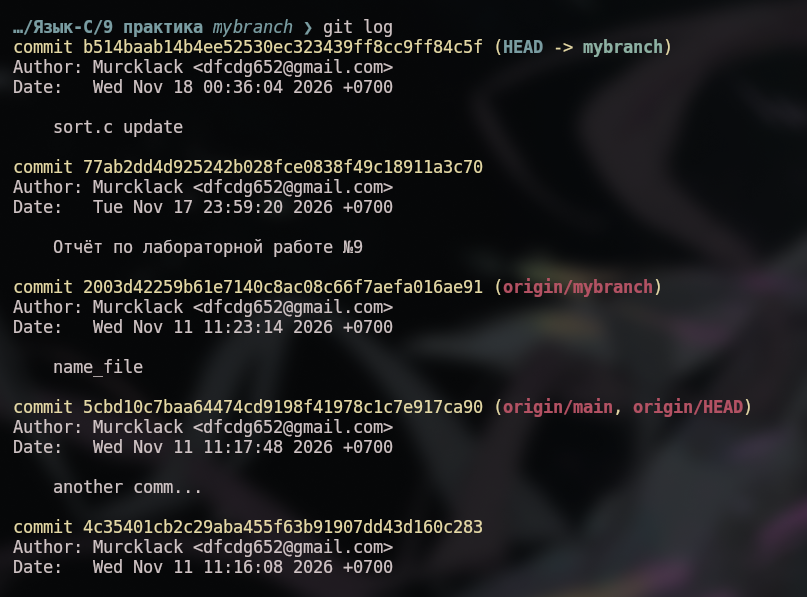

### 17–18. Добавление `printf("hello git\n")` и содержимое файла

В `main()` добавлена строка `printf("hello git\n");`. Содержимое `sort.c`:

```c
#include <stdio.h>

// Сортировка пузырьком (по возрастанию)
// arr - массив, size - количество элементов
void bubble_sort(int *arr, int size)
{
    ...
}

int main()
{
    int a[] = {4, 2};
    int size = 2;
    bubble_sort(a, size);
    for (int i = 0; i < size; i++)
    {
        printf("%d ", a[i]);
        printf("hello git\n");
    }
}
// Не убегай, это я твой коментарий, всё хрошо
// Да ладно тебе, никто ещё не умирал
```

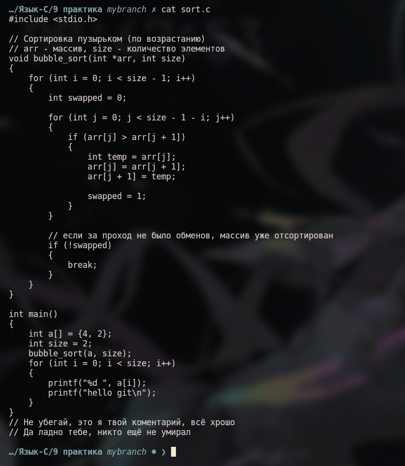

### 19. `git status` после правки

Файл `sort.c` снова изменён, но не добавлен в индекс:

```
Изменения, которые не в индексе для коммита:
    изменено: sort.c
индекс пуст (используйте «git add» и/или «git commit -a»)
```

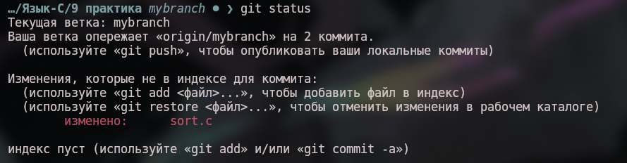

### 20–21. `git restore sort.c`

```
git restore sort.c
cat sort.c
```

`git restore` (без `--staged`) отменяет изменения в **рабочем каталоге** и возвращает файл к версии из индекса/последнего коммита. Строка `printf("hello git\n");` исчезла — файл снова содержит массив `{4, 2}` и вывод через `printf("%d ", a[i]);`.

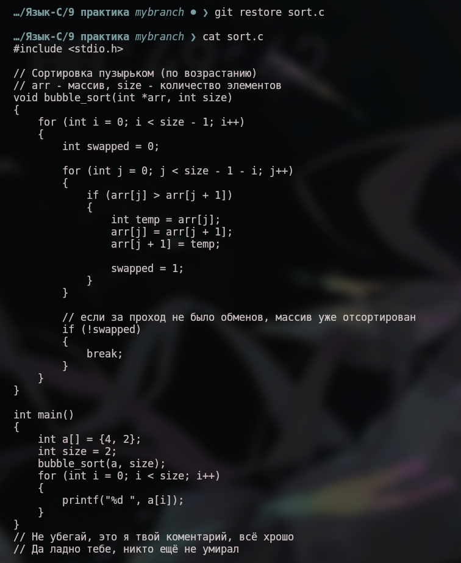

### 22. `git status` после restore

Рабочий каталог чистый, коммитить нечего. Ветка опережает `origin/mybranch` на 2 коммита (наш `sort.c update` и отчёт).

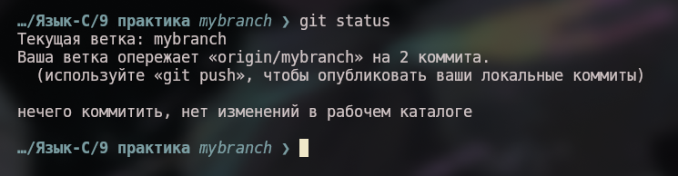

### 23. Push ветки `mybranch`

```
git push
```

Ветка `mybranch` отправлена в удалённый репозиторий — в журнале `origin/mybranch` теперь указывает на `b514baa`.

---

## Часть 2. Ветки и слияние (ff-merge)

### 1–2. Файл `greeting.txt` и два коммита

```
touch greeting.txt
git add greeting.txt
git commit -m "Add file greeting.txt"

echo "hello" >> greeting.txt
git add greeting.txt
git commit -m "Add content to greeting.txt"
```

Созданы коммиты `4b1df14` (пустой файл) и `3b3a97a` (содержимое `hello`).

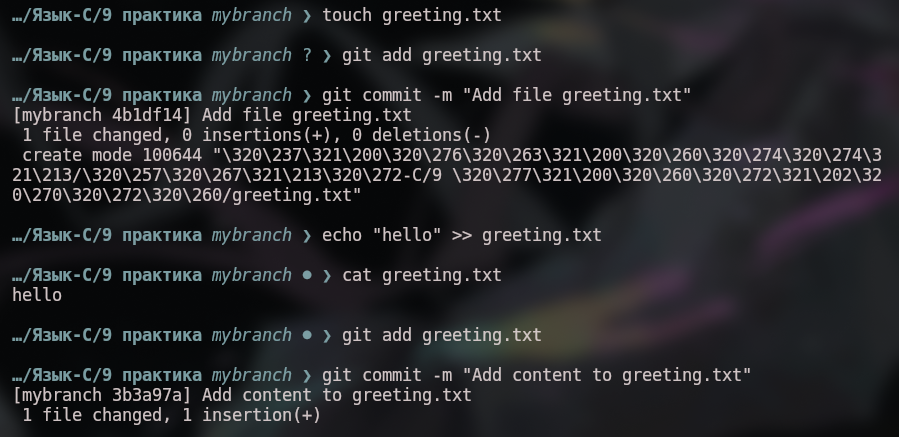

### 3–5. Ветка `feature/uppercase` и `git status`

```
git checkout -b feature/uppercase
git status
```

Ветка создана от `mybranch` и активна. `git status` показывает, что мы на `feature/uppercase` и изменений нет — новая ветка указывает на тот же коммит, что и `mybranch`.

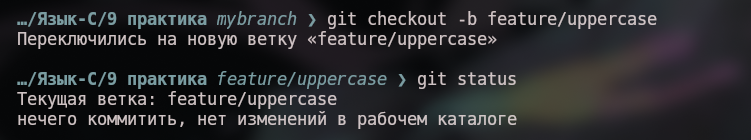

### 6–8. Приветствие в верхнем регистре, коммит и `git branch`

```
echo "HELLO" > greeting.txt
git add greeting.txt
git commit -m "edit greeting.txt"
git branch
```

Коммит `891f74c`. `git branch` показывает три ветки: `feature/uppercase` (текущая), `mybranch`, `main`.

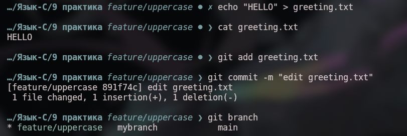

### 9. `git log --oneline --graph --all`

Видно, что `feature/uppercase` ушла вперёд относительно `mybranch` на один коммит (`891f74c`), а `main` стоит на отдельном коммите `fded397 Name2`.

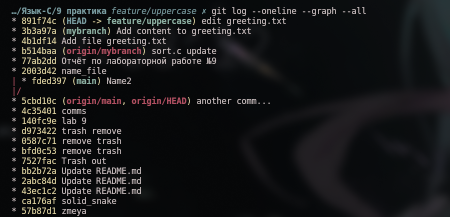

### 10–11. Возврат на главную ветку и `cat greeting.txt`

```
git switch main
cat greeting.txt
```

Файла `greeting.txt` в `main` нет: он был создан в ветке `mybranch` и унаследован веткой `feature/uppercase`, а в `main` этого файла никогда не было. Поэтому `cat` сообщает «Нет такого файла или каталога».

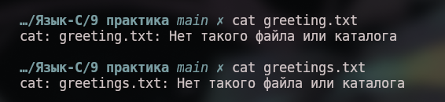

### 12. Сравнение веток

```
git diff main feature/uppercase
```

Diff показывает, что в `feature/uppercase` есть `file1.txt`, `greeting.txt` (с `HELLO`), папка `screenshots/`, отчёт, а в `main` — `file2.txt`. Ветки разошлись.

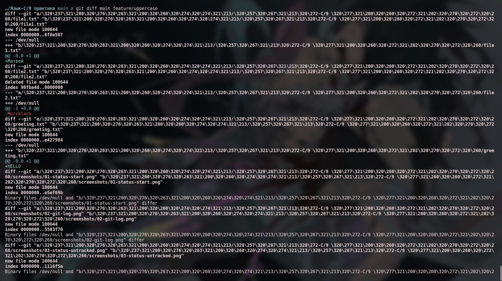

### 13. Объединение веток

```
git merge feature/uppercase
```

Так как `main` и `feature/uppercase` разошлись (у каждой стороны есть свои коммиты), слияние не может быть fast-forward, и Git создаёт **merge-коммит** `d99e02e` с двумя родителями — `fded397` (main) и `891f74c` (feature/uppercase). Он виден в журнале на шаге 17.

Повторный запуск той же команды уже сообщает «Уже актуально» — ветка `feature/uppercase` полностью влита в `main`.


### 14–15. Содержимое `greeting.txt` после слияния и удаление ветки

```
cat greeting.txt
git branch -d feature/uppercase
```

Теперь файл есть и в `main`, и в нём написано `HELLO` — версия из `feature/uppercase`. Ветка `feature/uppercase` удалена (была `891f74c`); коммиты при этом никуда не пропали — они уже вошли в историю `main` через merge-коммит.

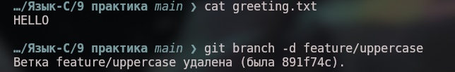

### 16. Слияние `mybranch` в `main`

```
git merge mybranch
```

Вывод «Уже актуально»: `mybranch` является предком `feature/uppercase`, а та уже влита в `main`, поэтому все коммиты `mybranch` уже есть в `main`. Отдельный merge-коммит не нужен.

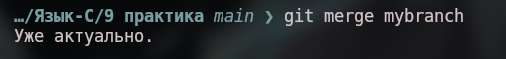

### 17. `git log --oneline --graph --all`

Граф показывает merge-коммит `d99e02e` и две линии истории: сторону `main` (`fded397 Name2`) и сторону `mybranch`/`feature/uppercase` (`2003d42` → `b514baa` → `3b3a97a` → `891f74c`). Ветка `mybranch` теперь указывает на `3b3a97a`, `main` — на merge-коммит.

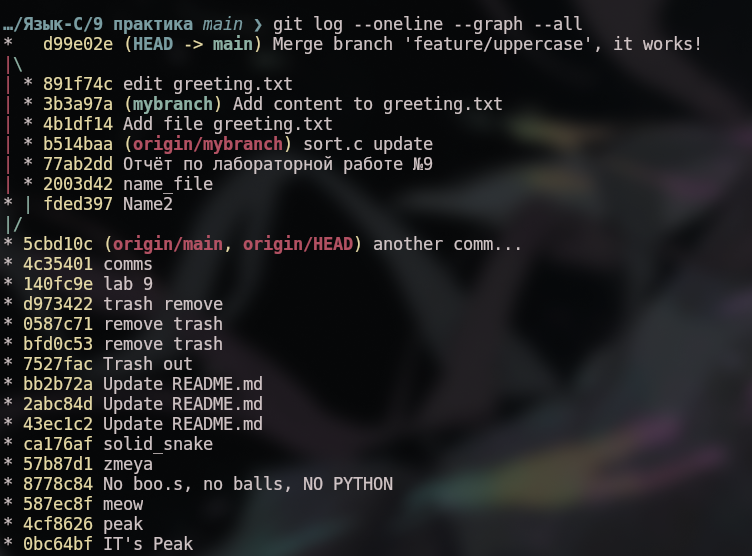

### 18–19. Push `main` и документа с результатами

```
git push
```

Изменения ветки `main` отправлены на GitHub: `5cbd10c..d99e02e  main -> main`. Вместе с ними ушёл и документ с результатами работы (`ОТЧЕТ_3.md`, `ОТЧЕТ_4.md` и папки со скриншотами), так как он входит в историю `main`.

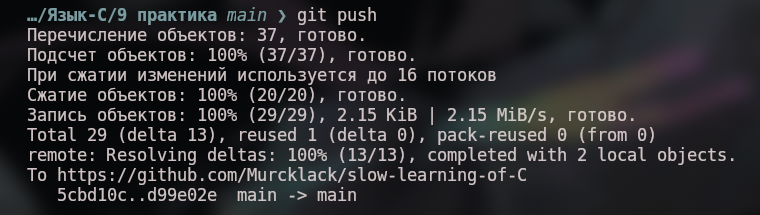

---

## Итог

В этой части отработаны:

- разница между тремя состояниями файла: последний коммит (`HEAD`), индекс (`stage`) и рабочий каталог;
- `git diff` (рабочий каталог ↔ индекс) и `git diff --staged` (индекс ↔ `HEAD`);
- почему `git status` может показывать один файл дважды;
- `git restore --staged` (убрать из индекса) и `git restore` (отменить правки в рабочем каталоге);
- создание ветки с именем через слэш (`feature/uppercase`), переключение и удаление ветки;
- сравнение веток через `git diff`;
- слияние веток: обычный merge с созданием merge-коммита и случай «Уже актуально»;
- чтение истории в виде графа (`git log --oneline --graph --all`) и push ветки `main`.
