# Лабораторная работа №9. Работа с Git — часть 3 (оценка 5)

**Студент:** Матвей (Murcklack)
**Репозиторий:** <https://github.com/Murcklack/slow-learning-of-C>
**Рабочая папка:** `Программы/Язык-C/9 практика`

> Продолжение отчётов `ОТЧЕТ_3.md` и `ОТЧЕТ_4.md`. Основная ветка в репозитории называется `main`, поэтому вместо `master` используется она.

---

## Часть 1. Конфликт слияния в `file.txt`

### 1–3. Ветка `branch1` и файл `file.txt`

```
git checkout -b branch1
echo "This is a relevant fact" > file.txt
git add file.txt
git commit -m "Start of the branch and new file"
```

Создана ветка `branch1`, в ней — файл `file.txt` с текстом `This is a relevant fact`. Коммит `82e8035`.

### 4–5. Та же правка в `main`

```
git switch main
echo "This is and indispensable truth!" > file.txt
git add file.txt
git commit -m "New file xd"
```

В `main` создан свой `file.txt` с другим текстом. Коммит `3ff049d`.

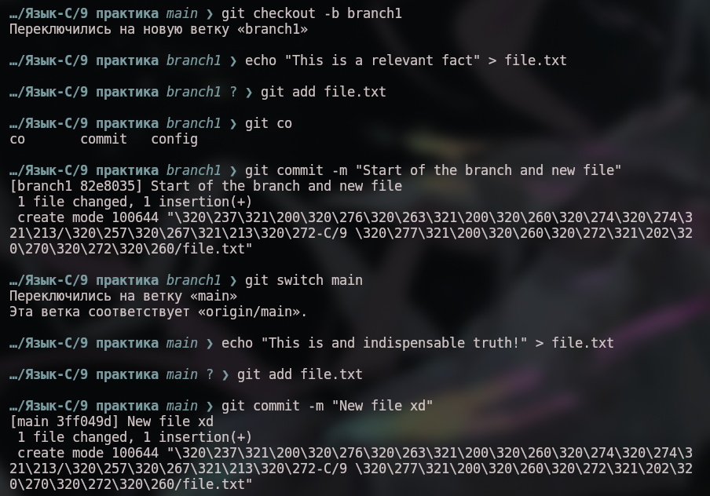

### 6. `git log --oneline --graph --all`

Ветки разошлись от общего предка `5160a36`: у `main` появился коммит `3ff049d`, у `branch1` — `82e8035`.

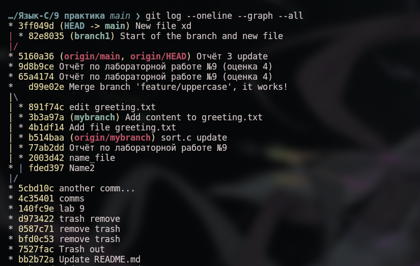

### 7. Слияние `branch1` в `main` — конфликт

```
git merge branch1
```

Git сообщает:

```
КОНФЛИКТ (добавление/добавление): Конфликт слияния в Программы/Язык-C/9 практика/file.txt
```

Это конфликт типа **add/add**: файла `file.txt` не было в общем предке, и обе ветки создали его независимо, с разным содержимым. Git не может выбрать, чья версия «правильная».

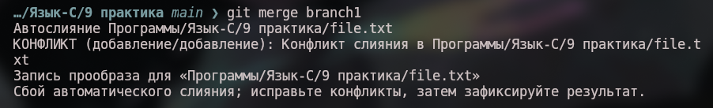

### 8. Что показывает `git status`?

```
У вас есть не слитые пути.
  (разрешите конфликты, затем запустите «git commit»)
  (используйте «git merge --abort», чтобы остановить операцию слияния)

Не слитые пути:
  (используйте «git add <файл>...», чтобы пометить разрешение конфликта)
	оба добавлены:   file.txt
```

Git прямо говорит, что слияние не завершено и что нужно сделать: отредактировать файл, затем `git add` и `git commit`.

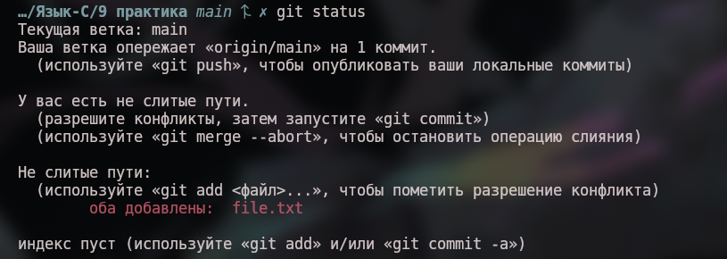

### 9. Просмотр файла и разрешение конфликта

В `file.txt` появились маркеры конфликта:

```
<<<<<<< HEAD (текущее изменение)
This is and indispensable truth!
=======
This is a relevant fact
>>>>>>> branch1 (входящее изменение)
```

Конфликт разрешён в VSCode: оставлена версия из `branch1` — `This is a relevant fact`. Маркеры `<<<<<<<`, `=======`, `>>>>>>>` удалены, файл добавлен в индекс:

```
git add file.txt
```

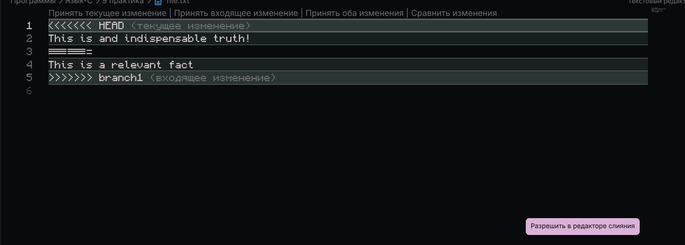

> Особенность выполнения: файл `mergesort.py` из второй части был создан ещё до завершения этого слияния. Поэтому коммит, которым завершилось слияние, называется `Created mergesort.py` и содержит сразу и разрешённый `file.txt`, и `mergesort.py` (подробнее — во второй части, шаг 2).

### 10. `git log --oneline --graph`

Скриншот сделан в момент, когда конфликт ещё не был закоммичен: merge-коммита пока нет, видна только линия `main` до `3ff049d`.

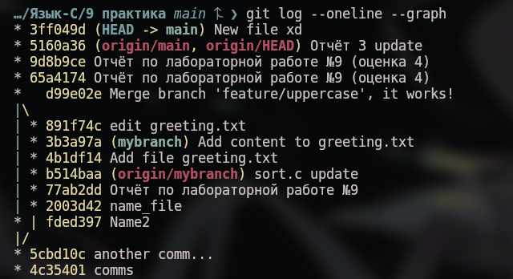

После выполнения `git commit` слияние завершается и в журнале появляется merge-коммит `ddfd2d7` с двумя родителями — `3ff049d` (main) и `82e8035` (branch1). Он хорошо виден на шаге 8 второй части.

### 11. Push изменений

Изменения `main` отправлены на GitHub (`git push`). Отдельного скриншота push в первой части нет, но факт отправки подтверждается журналом на шаге 8 второй части: `origin/main` указывает на `3ff049d`.

---

## Часть 2. Конфликт слияния в `mergesort.py`

### 1. Файл `mergesort.py` с содержимым `base.py`

В ветке `main` создан `mergesort.py` с заготовкой:

```python
def merge_sort(m):
    """Sort list m, using merge sort"""
    return m.sort()  # TODO: Replace with actual implementation
```

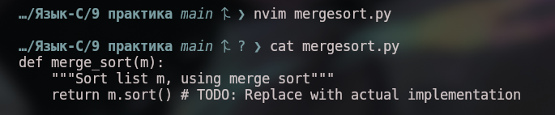

### 2. Индексация и коммит

```
git add mergesort.py
git commit -m "Created mergesort.py"
```

Первая попытка коммита не удалась:

```
error: Невозможно закоммитить, так как у вас имеются не слитые файлы.
fatal: Выход из-за неразрешённого конфликта.
```

Причина — незавершённое слияние из первой части: Git не разрешает коммит, пока в индексе есть неразрешённый `file.txt`.

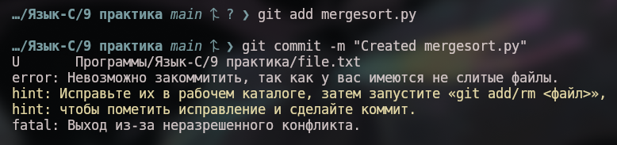

После `git add file.txt` тот же коммит завершил слияние:

```
git add file.txt
git commit -m "Created mergesort.py"
[main ddfd2d7] Created mergesort.py
```

Коммит `ddfd2d7` — merge-коммит: он объединяет ветки `main` и `branch1` и добавляет `mergesort.py`. Повторный `git merge branch1` сообщает «Уже актуально».

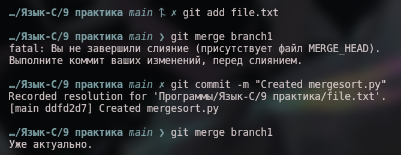

### 3. Ветка `Mergesort-Impl`

```
git checkout -b Mergesort-Impl
```

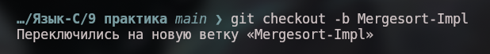

### 4. Содержимое `mergesort.py` из `righty.py`

Файл перезаписан реализацией из `righty.py`: две функции — `merge_sort2` (две части) и `merge_sort4` (четыре части), с переменными `right`, `fourth`.

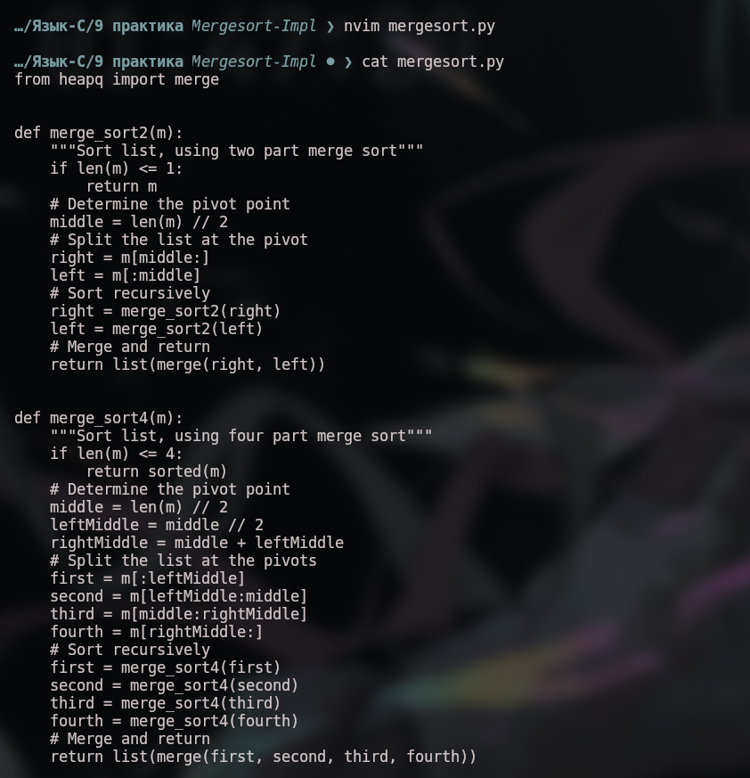

### 5. Коммит изменений

```
git add mergesort.py
git commit -m "Right mergesort"
```

Коммит `ed1f144`: 1 файл изменён, 39 добавлений, 3 удаления.

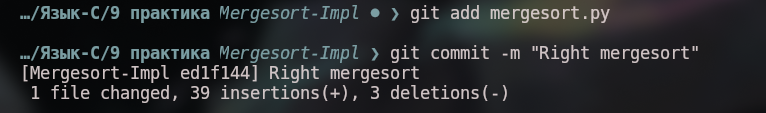

### 6. Возврат в `main` и содержимое из `lefty.py`

```
git switch main
```

Файл `mergesort.py` в `main` перезаписан реализацией из `lefty.py`. Отличие от `righty.py` — имена переменных и порядок строк: в `merge_sort2` сначала `left`, потом `right`, а в `merge_sort4` четвёртая часть называется `last`, а не `fourth`.

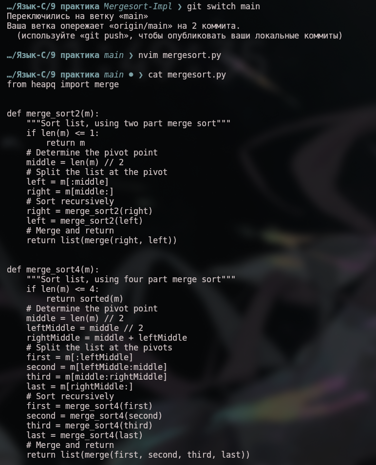

### 7. Коммит изменений в `main`

```
git add mergesort.py
git commit -m "Left mergesort.py"
```

Коммит `245879e` — те же 39 добавлений и 3 удаления, но с другим вариантом кода.

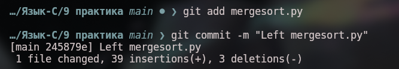

### 8. `git log --oneline --graph`

> На скриншоте команда выполнена с флагом `--all`, чтобы одновременно видеть обе ветки.

```
* 245879e (HEAD -> main) Left mergesort.py
| * ed1f144 (Mergesort-Impl) Right mergesort
|/
*   ddfd2d7 Created mergesort.py
|\
| * 82e8035 (branch1) Start of the branch and new file
* | 3ff049d (origin/main, origin/HEAD) New file xd
|/
* 5160a36 Отчёт 3 update
...
```

Видно, что `main` и `Mergesort-Impl` разошлись после общего merge-коммита `ddfd2d7`: у каждой ветки своя реализация `mergesort.py`.

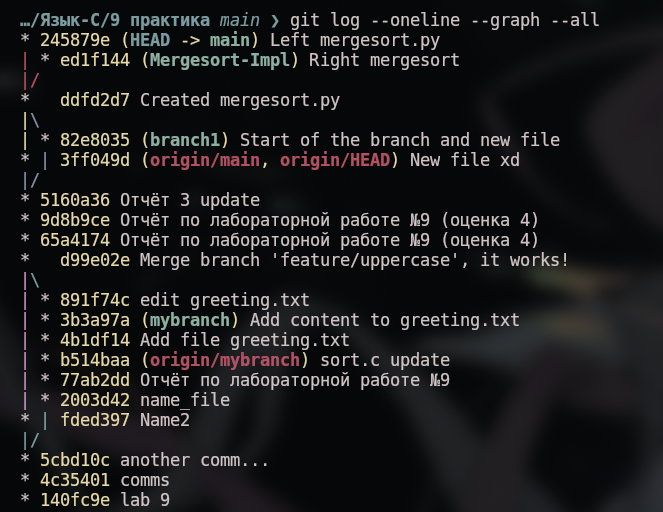

### 9. `git branch`

```
* main
  Mergesort-Impl
  branch1
  mybranch
```

Текущая ветка — `main`, рядом существуют `Mergesort-Impl` и старая `branch1`.

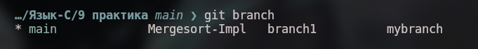

### 10. Слияние `Mergesort-Impl` в `main`

```
git merge Mergesort-Impl
```

Возникает конфликт **содержимого**:

```
КОНФЛИКТ (содержимое): Конфликт слияния в Программы/Язык-C/9 практика/mergesort.py
```

Обе ветки изменили одни и те же строки файла (фактически заменили заготовку двумя разными реализациями), поэтому автоматическое слияние невозможно.

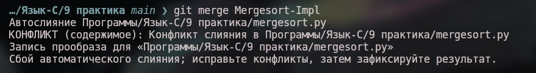

### 11. Разрешение конфликта и push

Конфликт разрешён: оставлена реализация из ветки `Mergesort-Impl` (`righty.py`) — с переменными `right` и `fourth`. Затем:

```
git add mergesort.py
git commit -m "updated mergesort for merging"
```

Коммит `d1f8dd3` — merge-коммит с родителями `245879e` (main) и `ed1f144` (Mergesort-Impl). Повторный `git merge Mergesort-Impl` сообщает «Уже актуально».

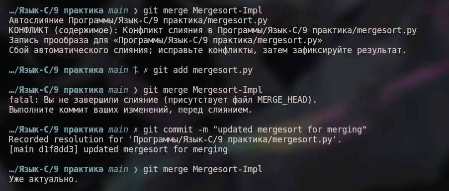

Push в `main`:

```
git push
...
3ff049d..d1f8dd3  main -> main
```

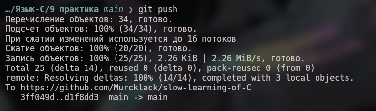

### 12. Push документа с результатами

Этот отчёт (`ОТЧЕТ_5.md`) вместе с папкой `screenshots5/` добавляется в `main`, коммитится и отправляется на GitHub:

```
git add ОТЧЕТ_5.md screenshots5
git commit -m "Отчёт по лабораторной работе №9 (оценка 5)"
git push
```

---

## Итог

В этой части отработаны:

- создание конфликта типа **add/add**: обе ветки независимо создали один и тот же файл;
- чтение `git status` во время конфликта и понимание строки «оба добавлены»;
- разрешение конфликта в редакторе: удаление маркеров `<<<<<<<`, `=======`, `>>>>>>>`, выбор нужной версии;
- завершение слияния через `git add` + `git commit` (коммит `ddfd2d7`);
- конфликт **содержимого** при слиянии двух реализаций `mergesort.py`;
- разрешение конфликта и создание merge-коммита `d1f8dd3`;
- чтение графа истории (`git log --oneline --graph --all`) и push в `main`.

## Приложение: итоговое содержимое `mergesort.py`

```python
from heapq import merge


def merge_sort2(m):
    """Sort list, using two part merge sort"""
    if len(m) <= 1:
        return m
    # Determine the pivot point
    middle = len(m) // 2
    # Split the list at the pivot
    right = m[middle:]
    left = m[:middle]
    # Sort recursively
    right = merge_sort2(right)
    left = merge_sort2(left)
    # Merge and return
    return list(merge(right, left))


def merge_sort4(m):
    """Sort list, using four part merge sort"""
    if len(m) <= 4:
        return sorted(m)
    # Determine the pivot point
    middle = len(m) // 2
    leftMiddle = middle // 2
    rightMiddle = middle + leftMiddle
    # Split the list at the pivots
    first = m[:leftMiddle]
    second = m[leftMiddle:middle]
    third = m[middle:rightMiddle]
    fourth = m[rightMiddle:]
    # Sort recursively
    first = merge_sort4(first)
    second = merge_sort4(second)
    third = merge_sort4(third)
    fourth = merge_sort4(fourth)
    # Merge and return
    return list(merge(first, second, third, fourth))
```
